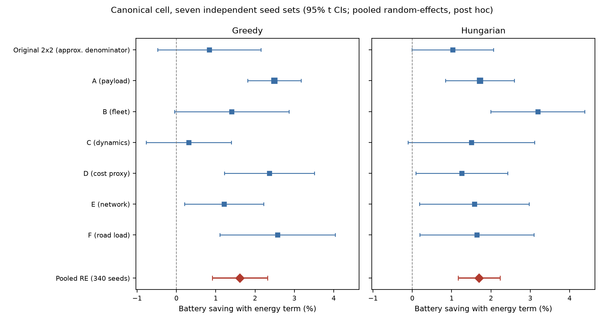

# When does energy-aware online dispatch save energy?

Reproducibility package for the paper *When Does Energy-Aware Online Dispatch Save Energy? Decision-Level Redundancy, Cumulative Savings and Operating Boundaries in Electric Ride-Pooling Fleets* (Saraban Salsabila, manuscript in preparation).

The study asks what adding an energy term to a time-based online vehicle–request assignment objective changes, and when it reduces battery use. It compares the time-only objective (αE = 0) with the energy-weighted objective (αE = 1) under Hungarian and Greedy assignment. It runs seven prespecified, matched-seed simulation campaigns of a six-seat electric campus shuttle fleet: **14,013 validated simulation runs** on **340 paired workload-seed blocks**.

This repository contains everything needed to check, rerun and extend every number in the paper:

- **Simulator and inputs:** the frozen simulator and its inputs.
- **Experiment code:** the exact code that produced each campaign.
- **Protocols:** all prespecified protocols.
- **Results:** every run-level table, contrast table and figure.
- **Archives:** the complete original campaign archives.
- **Verification:** scripts that recompute all reported statistics from the raw tables.

## Quick start (about 3 minutes, no simulation)

```bash
git clone https://github.com/SaraSsabila-19/ugv-energy-aware-dispatch.git
cd ugv-energy-aware-dispatch
python3 -m venv .venv && source .venv/bin/activate
python -m pip install -r requirements.txt
python verification/verify_repository.py      # 46 checks; expected last line: "46 of 46 checks passed. ALL PASS"
python analysis/synthesis.py                  # regenerates the replication synthesis and forest plots
```

To re-execute archived simulations from this repository and compare them value by value (about 1 minute):

```bash
python verification/reproduce_sample_runs.py          # 4 Experiment A runs; expected: "ALL REPRODUCED"
```

Publication figures (about 20 seconds; PDF with embedded fonts, 600-dpi PNG and TIFF, plotted numbers as CSV, draft captions):

```bash
python analysis/make_figures.py                  # Elsevier column widths (90 / 140 / 190 mm) -> figures/
python analysis/make_figures.py --style ieee     # IEEE widths (3.5 / 7.16 in)
```

`make verify`, `make synthesis`, `make figures`, `make reproduce` and `make test-kits` do the same. [docs/REPRODUCE.md](docs/REPRODUCE.md) explains how to rerun any complete campaign.

## Main findings

| Finding | Evidence | Status |
|---|---|---|
| Energy and time costs of candidate insertions are almost collinear (within-request r = 0.9973). | Original 2×2 | Descriptive |
| The same-state, decision-level saving is small (0.38–0.47%) and grows with the passenger-to-vehicle mass ratio ρ. | A: +0.67 pp Hungarian, +0.60 pp Greedy, Holm p = 4e-6, below the 1 pp margin | Prespecified, confirmed |
| Whole-run battery saving at the canonical cell: **1.62% [0.91, 2.32] Greedy, 1.70% [1.16, 2.23] Hungarian**. | 7 independent seed sets, 340 seeds, random-effects pooling | **Post hoc synthesis** |
| Passenger ride time is shorter with the energy term: **13.6 s [11.2, 16.1] Greedy, 11.0 s [8.5, 13.5] Hungarian**, with no loss of completed requests. | C, D, E, F; 160 seeds; I² = 0% | Post hoc synthesis of secondary outcomes |
| Energy weighting does not improve low-SOC service; fleet capacity does. | B: low-SOC loss 1.55 and 1.80 per 100 requests at 12 vehicles, none at 24/100 | Prespecified |
| Savings were not detected on a second network or under compressed demand. | E: 0 of 16 contrasts significant after Holm | Prespecified, inconclusive |
| At high road load, Greedy's saving is attenuated at 25% SOC. | F: −3.18 pp [−4.70, −1.66], Holm p = 0.0022 | Prespecified, single contrast |
| The temporal amplification of local savings is unresolved. | C: all 6 primary contrasts inconclusive | Prespecified, inconclusive |

Each 40-seed campaign can only detect effects of about 1.4–2.2 pp at 80% power (see `analysis/output/SYNTHESIS.md`). Non-significant single-study results are therefore uninformative about absence of an effect. The synthesis is labelled post hoc; it does not alter any prespecified verdict.



## Repository layout

```
src/frozen/app.py            frozen simulator (SHA-256 7b52bb55…a0a0), unchanged in every campaign
inputs/                      UTP campus road graph and demand hotspots (OpenStreetMap-derived)
experiments/                 exact experiment code, byte-identical to the kit that ran each campaign
  0_original_soc/            original energy-weight × initial-SOC experiment (kit v2)        320 runs
  A_B_payload_fleet/         A payload/mass ratio and B fleet/demand scale (kit v3.1)       2,000 + 960 runs
  C_dynamics/                C single-round pulses and sequential prefixes (kit v4)        8,013 runs
  D_cost_proxy/              D passenger-km surrogate and energy-weight sweep (kit v5)      1,120 runs
  E_network/                 E second network and compressed demand (kit v6)               640 runs
  F_road_load/               F measurement-informed road-load sensitivity (kit v7)          960 runs
results/                     protocols, validation reports, run-level tables, contrasts and figures per campaign
analysis/synthesis.py        post hoc replication synthesis of the canonical cell; outputs in analysis/output/
analysis/make_figures.py     the six paper figures -> figures/ (with source_data/ and CAPTIONS.md)
figures/                     generated figures (PDF, PNG, TIFF), plotted data and draft captions
verification/                repository verifier, sample-run reproduction, Experiment C native reference check
archives/                    complete original campaign export archives (with per-run outputs) and kit provenance
docs/                        reproduction guide, provenance and deviations, data availability statement
tools/publish_to_github.sh   one-time publication helper (copies archives, verifies, commits, pushes)
```

## Campaigns

| Campaign | Question | Design | Seeds | Runs |
|---|---|---|---|---:|
| Original 2×2 | Energy weight × initial SOC | 2 policies × SOC 100/25% × αE 0/1 | 21001–60001 (40) | 320 |
| A | Payload / mass ratio ρ | 5 mass configurations × 2 policies × αE 0/1 | 601001–700001 (100) | 2,000 |
| B | Fleet size and demand scale | 12/100, 24/100, 24/200 × SOC 100/25% × 2 policies × αE 0/1 | 701001–740001 (40) | 960 |
| C | Single-round and sequential effects | all-off/all-on references, every single-round pulse and prefix | 801001–840001 (40) | 8,013 |
| D | Passenger-km surrogate and weight sweep | 2 masses × 2 policies × 7 cost arms | 1001001–1040001 (40) | 1,120 |
| E | Network and demand transfer | UTP / UM district × 1,800 / 600 s window × 2 policies × αE 0/1 | 1101001–1140001 (40) | 640 |
| F | Road-load sensitivity | Crr 0.008/0.012/0.020 × SOC 100/25% × 2 policies × αE 0/1 | 1201001–1240001 (40) | 960 |

The canonical cell is 12 vehicles, 100 requests, 825 kg empty mass and 80 kg per passenger, 100% SOC, a 1,800 s window, the UTP network, Crr 0.012, and αE 1 versus 0. All campaigns use the same frozen simulator. Statistical inference is paired at the seed level, using 95% t intervals, sign-flip tests and Holm adjustment within prespecified families. Runs are not independent observations.

## What has been verified

`verification/verify_repository.py` checks, without trusting any reported number:

- **Simulator and kits:**
  - the frozen simulator and input hashes;
  - each kit is byte-identical to its archived zip and passes its own checksums;
  - each kit's protocol is identical to the protocol stored with its results.
- **Archives and results:** archive checksums match, and every file in `results/` is byte-identical to its archive member.
- **Recomputation from run-level data:**
  - all 66 prespecified A/B contrasts;
  - C, D, E and F seed effects and all their primary contrasts (n, mean, 95% CI);
  - Holm adjustments in every family.
- **Experiment C references:** 16 native-kit reruns are identical to C's all-off and all-on reference runs (`verification/c_native_reference_check/REPORT.md`).

`verification/reproduce_sample_runs.py` re-executes archived runs from this repository and compares every run-level value.

## Limitations

- This is a simulation study of one homogeneous, flat-road, low-speed fleet with unconstrained depot charging and two assignment policies.
- The second network uses synthetic, mapped demand.
- The road-load range comes from an external cargo-vehicle dataset; it is not a calibration of the target vehicle.
- Decision-level savings are defined over rounds in which both matchings assign the same number of requests (see docs/PROVENANCE.md).
- The raw per-run directories of the original 320-run 2×2 campaign are not included; its seed-level paired differences and summary are.

## Environment

The campaigns ran on CPython 3.14.4 with the packages pinned in `requirements-lock.txt`. Python 3.10 or later with `requirements.txt` is sufficient for verification and analysis. Simulation reproduction was also confirmed on CPython 3.13: values were identical except for floating-point rounding (relative 1e-16) in one derived correlation sum.

## Licence and citation

- **Code:** MIT ([LICENSE](LICENSE)).
- **Result data:** CC BY 4.0 ([LICENSE-DATA.md](LICENSE-DATA.md)).
- **Third-party material** (OpenStreetMap ODbL; ESOGU-ML5EV Apache-2.0): see [NOTICE.md](NOTICE.md).
- **Citation:** see [CITATION.cff](CITATION.cff).

This study builds on the earlier benchmark repository [ugv-energy-aware-assignment-benchmark](https://github.com/SaraSsabila-19/ugv-energy-aware-assignment-benchmark), which contains the same frozen simulator.
